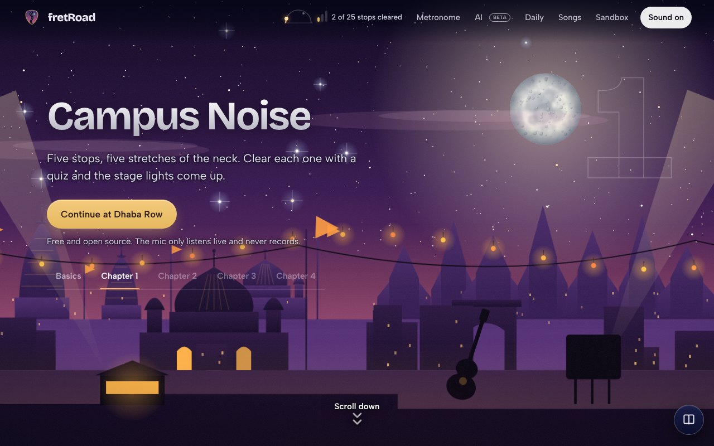
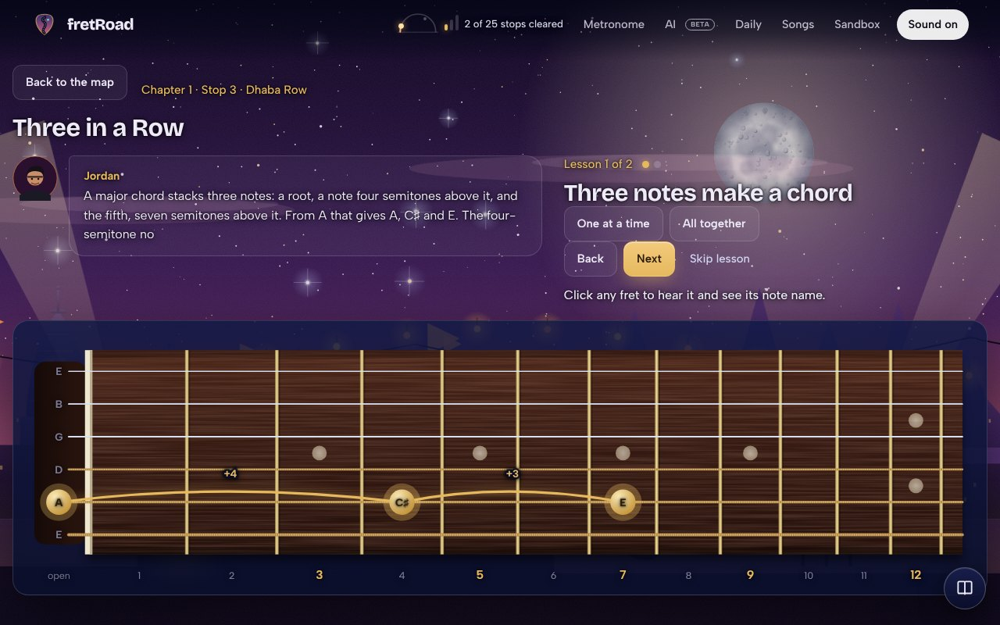
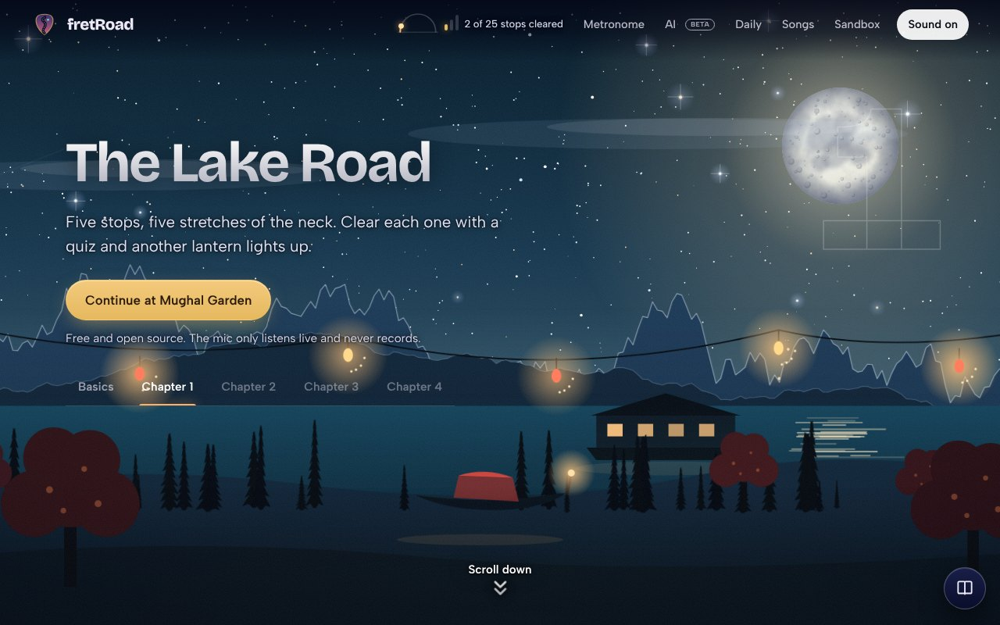

<div align="center">


# fretRoad

### Learn the guitar neck by driving down it.

A free, story-driven game that turns the fretboard from a pile of memorised shapes<br>into a map you actually know. No sign-up, no ads, no install. Just you, a guitar and the road ahead.

<br>

[**▶ &nbsp;Play fretRoad**](https://tanmayhc7.github.io/fretRoad/)

<br>


<br>



</div>

<br>

## 🌙 What is this?

Most fretboard apps flash a note name and ask you to hunt for it. fretRoad teaches the neck as a **pattern**: why the fifth is always two frets over and a string up, why a minor chord sits one fret from a major one, why the same shape works in every key.

You travel a road of stops. Each stop is a single idea, explained by a guide who talks you through it, and the world around you **wakes up as you learn**: lamps light, stage lights come up, the scenery fills in.

It is made for **intermediate players**, people who can already play but still feel lost above the fifth fret. A gentle **First Steps** chapter is there too, for anyone picking up a guitar for the very first time.

<br>

## 🧭 How a stop works

<table>
<tr>
<td width="25%" valign="top" align="center">

### 📖
**Lesson**

The idea, shown on a live fretboard you can click and hear.

</td>
<td width="25%" valign="top" align="center">

### 🧩
**Puzzle**

Now find it yourself, right there on the neck.

</td>
<td width="25%" valign="top" align="center">

### ✅
**Quiz**

Five questions. Pass it and the next stop opens.

</td>
<td width="25%" valign="top" align="center">

### 🔁
**Drills**

Practice unlocks afterwards, from beginner to advanced.

</td>
</tr>
</table>

<div align="center">

</div>

<br>

## 🎭 Pick your story

The lessons are identical in every story. Only the guide, the places and the scenery change, and you can switch any time without losing progress.

<table>
<tr>
<td width="50%" valign="top">


**Jordan**<br>
A college canteen, a battered guitar and a restless guitarist who wants to be a star. A warm night skyline, from old Delhi to Prague.

</td>
<td width="50%" valign="top">



**Heer**<br>
A valley, a lake and a bold, teasing guide who laughs at your careful playing. Dusk to dawn, one lantern per stop.

</td>
</tr>
</table>

<sub>Both stories are unofficial fan tributes to the film *Rockstar* (2011), with original text and original drawings. They are not affiliated with or endorsed by the film's makers, and use no lines, lyrics or likenesses from it.</sub>

<br>

## ✨ Everything it can do

<table>
<tr>
<td width="50%" valign="top">

### 🎤 It listens to you
Turn on the mic and fretRoad checks you are really playing the right notes. **Chords are built one string at a time**, so a buzzing finger shows up straight away. A built-in tuner shows how many cents off you are.

</td>
<td width="50%" valign="top">

### 🎶 Your own songs, with a band
Import a chord chart from text, a PDF or even a **photo**, then play along with a backing band that follows the chart. It tells you how late your chord changes were and drills the slow ones.

</td>
</tr>
<tr>
<td valign="top">

### 🎧 Hear what you played
Record yourself and fretRoad listens back: it names the chords it hears and flags the spots where they differ from the chart.

</td>
<td valign="top">

### 🥁 Timing that holds up
**Strum in Time** gives you a 3-2-1 countdown, a free practice bar, then scored bars. A metronome rides along on every screen, with odd meters like 5/8 and 7/8.

</td>
</tr>
<tr>
<td valign="top">

### 🖐️ Daily finger workouts
Ten exercises, one a day, five minutes each, with a level for beginners, intermediates and advanced players. A calendar and streak keep you honest.

</td>
<td valign="top">

### 🔍 Explore the neck
The **sandbox** shows any scale or chord shape in any key, and the **chord finder** names whatever you tap on the fretboard. Switch to **DADGAD** tuning and everything follows.

</td>
</tr>
<tr>
<td valign="top">

### 🌱 Starting from zero
No guitar yet? **First Steps** covers the strings, holding the guitar, frets and finger numbers, tuning, chord boxes and tab, and your first chords. Never in your way if you already know it.

</td>
<td valign="top">

### 👥 One device, many players
Add several players on the same device. Everyone gets their own profile and their own progress.

</td>
</tr>
</table>

Plus **left-handed mode**, a light theme, a daily reminder, backup and restore of your progress to a file, a first-visit tour, and an optional **riff helper** that can plug into your own AI model ([how](docs/BRING_YOUR_OWN_MODEL.md)).

<br>

## 🗺️ What you will learn

<details open>
<summary><b>Five chapters, 25 stops</b></summary>

<br>

| Chapter | Stops |
|---|---|
| **Basics: First Steps** | The six strings and how to hold the guitar, frets and finger numbers, the musical alphabet, tuning by ear and with the tuner, reading chord boxes and tab with E minor, A minor and the open chord set. Optional: chapter 1 is open without it |
| **1. First stretches of the neck** | Find every A, the fifth above, a major chord, minor, octave shapes |
| **2. The pentatonic box** | The pentatonic box, the job of each note, box two, the blue note, major pentatonic |
| **3. Seven notes, five moods** | Natural minor, Dorian, Mixolydian, Lydian, Phrygian |
| **4. Shapes that slide** | The E-shape and A-shape barre chords, major to minor, two homes for every chord |

Each chapter has its own name in each story (Jordan's chapter 1 is *Campus Noise*, Heer's is *The Lake Road*). Four right on the first try opens the next stop, and a chapter opens once the one before it is cleared.

</details>

<details>
<summary><b>Practice drills, in three tiers</b></summary>

<br>

Each drill unlocks when the stop that teaches it is cleared.

- **Beginner:** note hunting, open strings, intervals, open chords, triads, time signatures, tempo and note values, strumming patterns, tuner, a timed fretboard sprint, finger-gym walks
- **Intermediate:** scale spelling and degrees, chord qualities and families, barre shapes, circle of fifths, capo and shapes, triad inversions, arpeggios, strum in time, rhythm reading, pentatonic boxes, melody by ear, chord and scale ear training
- **Advanced:** the seven modes, 19 scales, extended chords, chord-scale matching, the CAGED system, polyrhythms, odd-meter comping, transcribing by ear
- **No guitar nearby?** There are drills for that too.

The full list, including what is planned, is in [PRACTICE_IDEAS.md](PRACTICE_IDEAS.md).

</details>

<br>

## 🚀 Start in ten seconds

**[Open fretRoad in your browser](https://tanmayhc7.github.io/fretRoad/)** and press the big yellow button. That is the whole setup.

- Use Chrome or Edge for the best sound and microphone support.
- Your progress lives in your browser. To move it to another device, use **Save progress to file** at the bottom of the map.
- 🔒 **Privacy:** audio is analysed live in your browser and thrown away. Nothing is recorded, stored or sent anywhere.

<br>

## 💛 Help it find its way

fretRoad is a free, non-commercial labour of love, kept by one person. If it helped you get around the neck:

- ⭐ **Star the repo** so other guitarists can find it
- 🎸 **Tell a friend** who has been stuck in the first position
- 💬 **Tell me what worked and what didn't**: the footer of the game has a *Report a problem or share an idea* link that opens a pre-filled GitHub issue (nothing is sent until you press Submit), or [open an issue](https://github.com/tanmayhc7/FretRoad/issues/new/choose) directly

> **Honest note:** fretRoad has **not yet been tested with a real acoustic guitar**, so the note detector's tolerances are tuned on synthetic tones. If it misreads your playing, that is exactly the feedback this project needs.

<br>

<details>
<summary><b>🛠️ For tinkerers: run it, hack on it, add a story</b></summary>

<br>

fretRoad is plain HTML, CSS and JavaScript, built on SVG and the Web Audio API. **No framework, no build step, no dependencies**, and the only network request is for two web fonts. Scripts are classic `<script>` tags in `index.html`, so load order matters.

**Run it locally**

```bash
git clone https://github.com/tanmayhc7/FretRoad.git
cd FretRoad
python3 -m http.server 8000     # then open http://localhost:8000
```

Opening `index.html` directly also works for most things, but serving it over `localhost` is the safest way to get microphone access.

**Layout**

```
index.html            page shell, loads everything in order
css/                  style.css, redesign.css, songs.css
js/                   core, lessons and levels, quizzes, drills, audio, mic,
                      metronome, rhythm, finger exercises, chord finder,
                      profiles, Chromecast sender, backup, tour, tester
js/songs/             chart parsing, OCR import, chord diagrams, backing band,
                      chord listening, recording and analysis, tunings
js/stories/           one file per storyline (jordan, heer)
js/world/             the animated backdrops
js/ai/                the bring-your-own-model riff helper
cast/                 the Chromecast TV receiver
docs/  tools/  tests/
```

**Add a storyline:** copy a file in `js/stories/`, change the text, add a `<script>` line in `index.html`. **Add a stop:** write it with `makeLevel` in a `levels-ch*.js` file, add its id to `CHAPTERS` in `chapters.js`, and give each story a place name and a line for it.

**Tests** drive the real page in headless Chromium with Playwright. Run the suites one at a time, for example `python3 tests/ui_core.py`; `python3 tests/globals.py` checks that no two scripts define the same global. See [tests/README.md](tests/README.md).

**Tester build:** `index.html?tester=1`, or `python3 tools/build_standalone.py --tester`, unlocks every stop and drill, keeps its own save, and adds a checklist and a mic lab for real-guitar testing.

**Chromecast (experimental):** a TV receiver for the lobby, group jams and the daily exercise is included in `cast/`. It needs a Cast Application ID of your own, entered in Settings. Setup notes are in [docs/CHROMECAST.md](docs/CHROMECAST.md).

**Contributing:** pull requests are welcome, but the maintainer decides what is merged, so please open an issue first for anything large. Contributions come in under the same AGPL-3.0 terms with a `Signed-off-by` line and no contributor agreement. See [CONTRIBUTING.md](CONTRIBUTING.md).

</details>

<br>

## 📜 License

[AGPL-3.0](LICENSE). Free to use, study, change and share. If you run a modified version for others, including as a website, you must offer them your modified source under the same licence. Versions published up to commit 4837375 were released under the MIT licence and stay available under it.

<div align="center">
<br>
<sub>Made for people who would rather understand the neck than memorise it.</sub>
</div>
