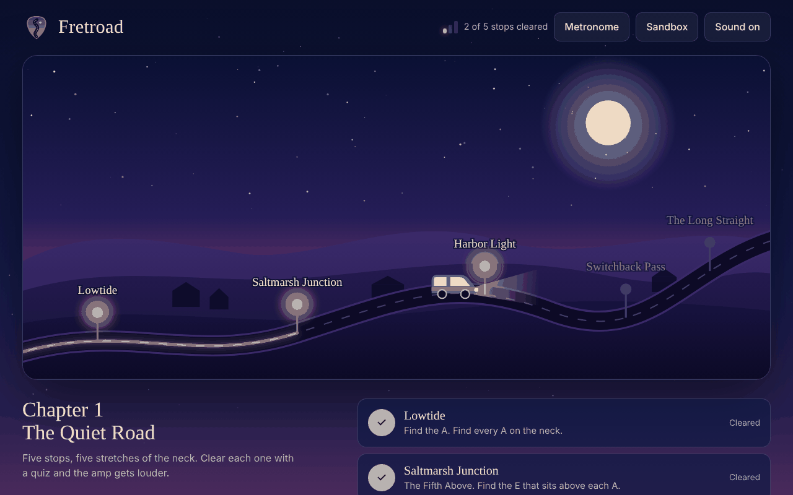
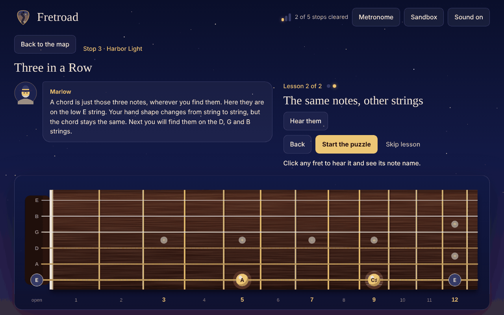
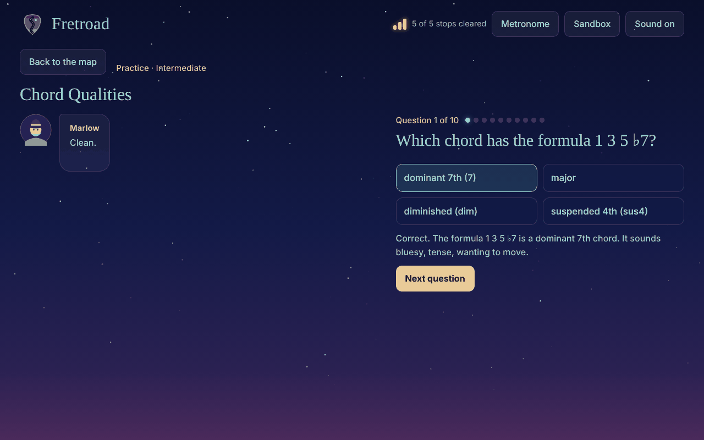
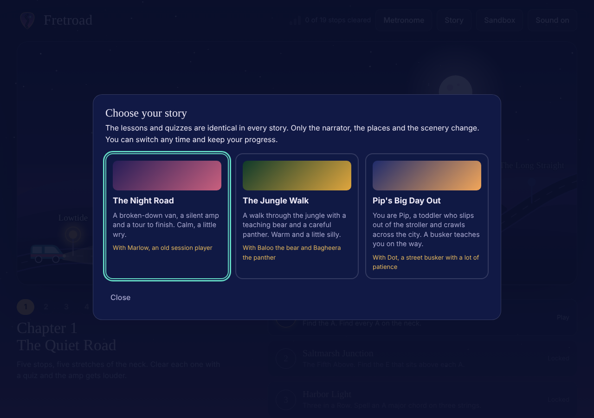
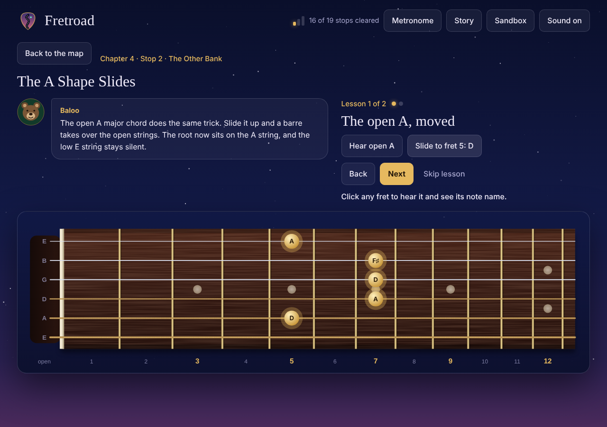
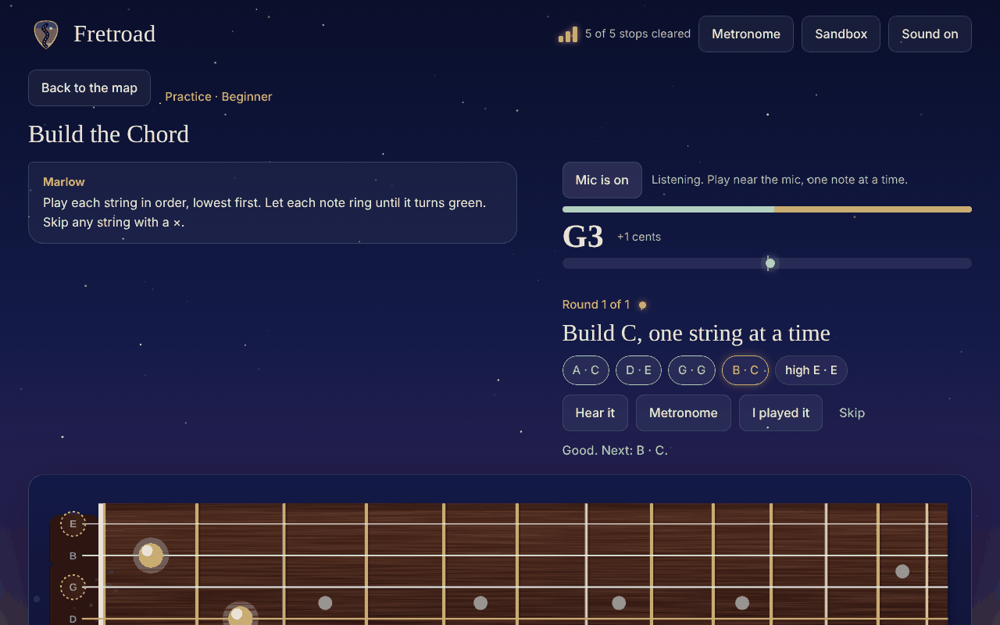
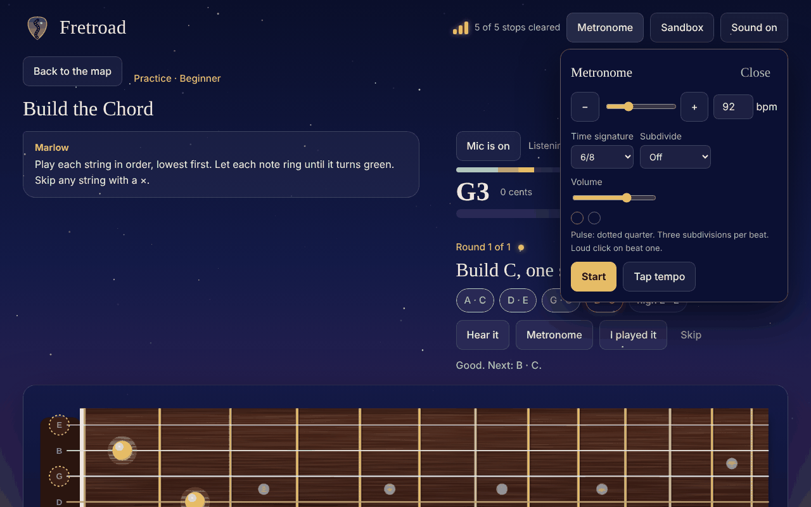

<div align="center">


# fretRoad

**Learn the guitar neck by driving down it.**
A story-driven fretboard game for players who know a few chords and want to understand what they are playing.

[**▶ Play it in your browser**](https://tanmayhc7.github.io/FretRoad/) · [Practice drills](PRACTICE_IDEAS.md)


<br>



</div>

---

## What is this?

Most fretboard apps flash a note name and ask you to find it. fretRoad teaches the neck as a **pattern**: why the fifth is always two frets over and a string up, why a minor chord is one fret away from a major one, why the same shape works in every key.

You walk a road of stops, each one a single idea, with a guide who talks you through it. Pick the story you like: a night road with an old session player, a jungle trail with a bear and a panther, or a toddler's big day across the city. The lessons are identical in every story.

Each stop on the road is one idea:

1. **Lesson** first, with the idea shown on a live fretboard you can click and hear.
2. **Puzzle** that makes you find it yourself.
3. **Quiz** that has to be passed before the next stop opens.
4. **Practice drills** unlock afterwards, from beginner to advanced.

It is built for intermediate players: you can already play, but the neck still feels like a pile of memorised shapes.

<div align="center">

</div>

## Try it

The quickest way is the [live version](https://tanmayhc7.github.io/FretRoad/). To run it locally instead, there is no build and no dependencies:

```bash
git clone https://github.com/tanmayhc7/FretRoad.git
cd fretRoad
open index.html        # macOS. On Linux: xdg-open. On Windows: start
```

Use Chrome or Edge for the best sound and microphone support. Click anywhere on the page once so the browser allows audio.

## What is in it

<table>
<tr>
<td width="50%" valign="top">

### Four chapters, 19 stops
| Chapter | Stops |
|---|---|
| **1. The Quiet Road** | Find every A, the fifth above, a major chord, minor, octave shapes |
| **2. Boxed In** | The pentatonic box, the job of each note, box two, the blue note, major pentatonic |
| **3. Same Notes, New Home** | Natural minor, Dorian, Mixolydian, Lydian, Phrygian |
| **4. Up the Neck** | The E-shape and A-shape barre chords, major to minor, two homes for every chord |

Each stop has a lesson, a puzzle and a five-question quiz. Four right on the first try opens the next stop. A chapter opens once the one before it is cleared.

</td>
<td width="50%" valign="top">

### 42 practice drills
Three tiers, each unlocked by the stop that teaches it.

- **Beginner:** note hunting, open strings, intervals, open chords, triads, time signatures, tempo and note values, strumming patterns, tuner, a timed fretboard sprint, finger-gym walks
- **Intermediate:** scale spelling and degrees, chord qualities, chord families, barre shapes, circle of fifths, capo and shapes, triad inversions, arpeggios, strum check, triads on string sets, pentatonic boxes, melody by ear, chord and scale ear training
- **Advanced:** the seven modes, 19 scales, extended chords, chord-scale matching, minor-key and seventh-chord families, the CAGED system, polyrhythms

The full list, including what is planned, is in [PRACTICE_IDEAS.md](PRACTICE_IDEAS.md).

</td>
</tr>
</table>

<div align="center">

</div>

## Pick your story

Progress is stored in your browser. Use **Save progress to file** and **Load progress from file** at the bottom of the map to move it to another browser or device.

The same lessons, puzzles and quizzes sit under three storylines. Choose on first launch, or switch any time from the **Story** button without losing progress. Each story changes the narrator, the place names, the dialogue and the map scenery.

<div align="center">

</div>

- **The Night Road:** a broken-down van and an old session player called Marlow.
- **The Jungle Walk:** Baloo the bear and Bagheera the panther, drawn from Kipling's public-domain *Jungle Book*.
- **Pip's Big Day Out:** you are Pip, a toddler crawling across the city, with a patient busker called Dot. An original story.

<div align="center">

</div>

## It listens to you

Turn on the microphone and fretRoad checks that you are really playing the right notes.

- **Chords are built one string at a time**, lowest first. Each note is confirmed before the next, so a buzzing finger shows up straight away instead of hiding in a strum.
- **Scale Runner** lets you pick any key and any of 19 scales, then play it up, down or both.
- **Tuner and mic check** shows the note you are playing and how many cents off it is.
- Pitch comes from the YIN algorithm, with a noise gate calibrated to your room. Echo cancellation and auto-gain are switched off so an acoustic guitar is not "cleaned up" out of existence.

> **Privacy:** audio is analysed live in your browser and discarded. Nothing is recorded, stored or sent anywhere.

<div align="center">

</div>

## A metronome that follows you around

Open it from the header on any screen.

<table>
<tr>
<td valign="top">

- 30 to 240 bpm, with tap tempo
- 2/4, 3/4, 4/4, 5/4, 5/8, 6/8, 7/8 (grouped 2+2+3), 9/8, 12/8
- Subdivisions: eighths, triplets, sixteenths
- Accent on beat one, with beats lit in time
- Compound meters count the big beats, so 6/8 feels like two

</td>
<td width="340" valign="top">

</td>
</tr>
</table>

## Your own songs, with a band that listens

Open **Songs** in the header.

- **Import a chord chart**: paste text (chords above the words, `[C]` in brackets, or `| C | G |` bars), drop a `.txt` / `.cho` file, a PDF, or a photo. PDFs and photos are read in your browser (PDF.js and Tesseract, loaded only when you use them). Check the chords it found and fix any slip before saving. Links to Songsterr or Ultimate Guitar cannot be fetched, so copy the chart text instead.
- **Play along**: a backing band (click, strummed guitar, or drums, bass and guitar) follows the chart. You see the chord now, the chord next, a diagram for each, how many fingers move, and a tip for the change. The tempo, beats per chord, capo and key are adjustable.
- **It listens**: turn on the mic and it tells you whether you are playing the chord on the chart, and how late your change was. Slow changes collect under "Your chord changes", each with a **Drill** button that loops just that pair, starting slow and speeding up after four clean changes.
- **Jam tracks** in any key (12-bar blues, pop, folk, minor groove, Andalusian, ii-V-I, and Dorian, Mixolydian, Lydian and Phrygian vamps with a solo hint) for when you just want to solo.

## Daily practice, left-handed mode, light theme, tour

- **Daily practice**: one exercise a day with a five-minute timer and click. The ten exercises rotate in a shuffled 10-day cycle, so none repeats within ten days. A calendar shows the days you practised and the ones you missed, plus your streak.
- **Sandbox** shows scales or chord shapes (open and barre) in any key.
- **Left-handed mode** mirrors the fretboards and chord diagrams. It is switchable in Settings, the Sandbox, Songs and the play-along.
- **Theme**: dark, light or match the device (Settings, bottom of the map).
- **Reminder**: Settings can send a daily notification at a time you choose. A web page cannot wake itself up, so it only appears while a fretRoad tab is open; the same screen downloads a repeating calendar event (.ics) for a reminder when it is closed.
- **Tour**: a short first-visit walkthrough with "Skip tour" and "Don't show this again" (remembered). Replay it from Settings.

## How it is built

Plain JavaScript, SVG and the Web Audio API. No framework, no build step, and the only network request is for two web fonts. Open `index.html` and it runs.

```
index.html            page shell, loads the files below in order
css/style.css         all styling
css/songs.css         songs, play-along, warm-up, settings, light theme
js/
  core.js             constants, helpers, saved progress
  backup.js           save/load progress to a file (move it between browsers)
  audio.js            plucked-string synthesiser (Karplus-Strong)
  fretboard.js        the SVG fretboard
  story-core.js       storyline engine and the story picker
  stories/            one file per storyline (road, jungle, city)
  level-tools.js      helpers for writing levels
  levels-ch1..4.js    the stops: lessons, puzzles, quiz lists
  chapters.js         chapters, unlocking, map tabs
  quiz-bank*.js       quiz question generators for the stops
  quiz-ui.js          quiz and practice screens
  views.js            map, lessons, puzzles, sandbox
  theory.js           chord and scale theory
  drills*.js          the 42 practice drills
  metronome.js        metronome with time signatures
  mic.js, play.js     microphone pitch detection and play-along drills
  songs/              chord parsing, chart import, diagrams, backing band, chord listener, play-along
  warmup.js, prefs.js, tour.js  daily practice and calendar; theme and left-handed settings; first-visit tour
  main.js             header controls and routing
tools/build_standalone.py   bundle everything into one html file
tests/                browser and quiz tests (see tests/README.md)
```

- A plucked-string synthesizer makes every sound, so the fretboard is audible with no audio files.
- Question generators build each quiz and drill from music theory rules, so answers are correct by construction. They are stress-tested over thousands of generated questions per type.
- Pitch detection was tested on generated guitar-like tones from E2 to E5.
- The whole game is driven end to end in a headless browser, including a fake guitar signal fed through the microphone.

**Add a storyline:** copy `js/stories/road.js`, change the text, add a `<script>` line in `index.html`. **Add a stop:** write it with `makeLevel` in a `levels-ch*.js` file, add its id to `CHAPTERS` in `chapters.js`, and give each story a place name and a clear line for it.

Progress and your story choice are saved in your browser's local storage and never leave your device.

> It has **not yet been tested with a real acoustic guitar**, so the detector's tolerances are tuned on synthetic tones. If it misreads your playing, that is exactly the feedback this project needs.

## Contributing

Ideas, bug reports and especially **real-guitar test recordings** are welcome. Open an issue, or try a drill and tell us where the lesson confused you.

## License

[MIT](LICENSE). Free to use, change and share.

<div align="center">
<br>
<sub>Made for people who would rather understand the neck than memorise it.</sub>
</div>
